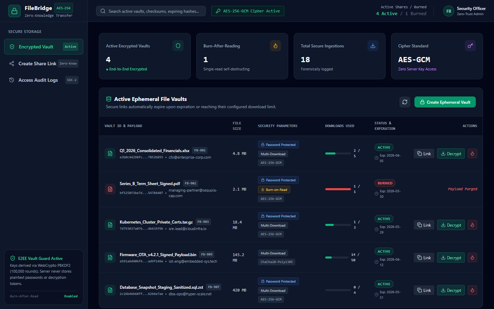
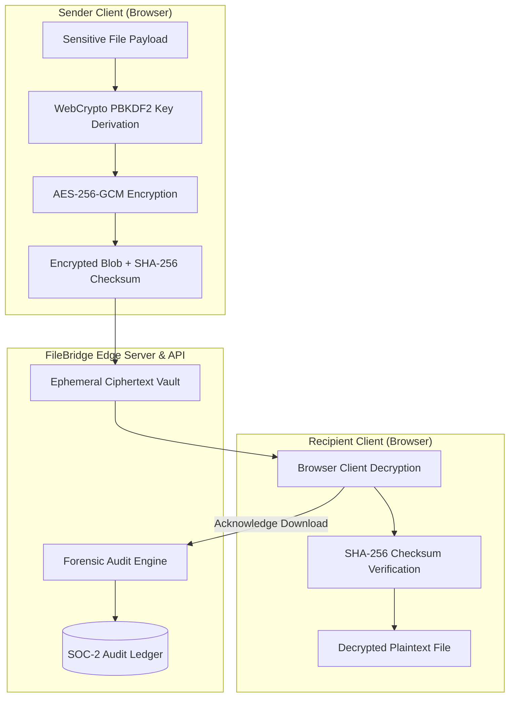

<div align="center">

# FileBridge — Zero-Knowledge Ephemeral File Transfer & Vault Security Platform

[](LICENSE)
[](https://en.wikipedia.org/wiki/Galois/Counter_Mode)
[](https://www.aicpa-cima.com/)
[](https://reactjs.org/)
[](https://nodejs.org/)
[](https://docker.com)

**Enterprise-grade secure file sharing with client-side end-to-end encryption, ephemeral expiring links, burn-after-reading memory purging, and forensic audit logging.**

[Architecture](#system-architecture) • [Live Dashboard](#live-dashboard-preview) • [Benchmark Data](#benchmark-dataset) • [API Reference](#rest-api-documentation) • [Quickstart](#quickstart-guide)

</div>

---

## Live Dashboard Preview

<div align="center">
  
</div>

---

## Core Capabilities

- **Zero-Knowledge Architecture:** Cryptographic keys are generated and held exclusively in browser memory (WebCrypto PBKDF2 with 100,000 rounds). The backend server stores only ciphertext payloads and never has access to plaintext data.
- **Configurable Ephemeral Expiration:** Flexible lifecycle controls with automated link revocation spanning from 1-hour flash transfers to 7-day multi-peer shares.
- **Burn-After-Reading Destruction:** Payloads configured with single-use policies are purged from disk and memory immediately upon the first completed decryption stream.
- **Forensic Tamper-Evident Audit Trails:** Append-only access logs recording IP addresses, geographic endpoints, timestamped HMAC hashes, and passkey verification statuses.
- **Client-Side SHA-256 Integrity Verification:** Automatic pre- and post-transfer cryptographic checksum comparison guaranteeing zero bit-rot or payload tampering.

---

## System Architecture



---

## Benchmark Dataset

FileBridge includes production-simulated sharing and audit benchmark data located in [`data/kaggle_filebridge_shares_benchmark.csv`](data/kaggle_filebridge_shares_benchmark.csv):

| Vault ID | Filename | Size | Encryption | Max Downloads | Burn On Read | Status |
| :--- | :--- | :--- | :--- | :--- | :--- | :--- |
| `FB-901` | Q1_2026_Consolidated_Financials.xlsx | 4.8 MB | AES-256-GCM | 5 | False | `ACTIVE` |
| `FB-902` | Series_B_Term_Sheet_Signed.pdf | 2.1 MB | AES-256-GCM | 1 | True | `BURNED` |
| `FB-903` | Kubernetes_Cluster_Private_Certs.tar.gz | 18.4 MB | AES-256-GCM | 3 | False | `ACTIVE` |
| `FB-905` | Firmware_OTA_v4.2.1_Signed_Payload.bin | 145.2 MB | ChaCha20 | 50 | False | `ACTIVE` |
| `FB-907` | Database_Snapshot_Staging_Sanitized.sql.zst | 420.0 MB | AES-256-GCM | 4 | False | `ACTIVE` |

---

## REST API Documentation

### 1. List Active Ephemeral Vaults
```http
GET /api/v1/shares
```

### 2. Create Ephemeral Share Link
```http
POST /api/v1/shares
Content-Type: application/json

{
  "filename": "quarterly_audit_2026.pdf",
  "sizeMb": 8.4,
  "expirationHours": 24,
  "maxDownloads": 2,
  "hasPassword": true,
  "burnAfterReading": false,
  "sender": "sec-ops@enterprise.internal"
}
```

### 3. Decrypt & Download Payload
```http
POST /api/v1/shares/:id/download
Content-Type: application/json

{
  "passphrase": "Vault#Pass2026!"
}
```

---

## Quickstart Guide

### Prerequisites
- Node.js 18+ or Docker & Docker Compose
- Git

### Local Development

```bash
# Clone the repository
git clone https://github.com/Prasunnandi/filebridge-secure-sharing.git
cd filebridge-secure-sharing

# Launch Backend API
cd backend
npm install
npm start &

# Launch Frontend React Client
cd ../frontend
npm install
npm run dev
```

### Docker Compose Deployment

```bash
docker-compose up --build
```
Access the application at `http://localhost:3000`.

---

## License

Distributed under the MIT License. See `LICENSE` for more information.
